# Prompt: rebuild the LUMPI Teacher Dashboard

Give this whole file to a coding model. It describes the dashboard in
`dashboard/` and `laptop/dashboard_server.py` closely enough to rebuild it
from nothing. Every rule has its reason next to it. If a detail here and your
own taste disagree, follow this file. The reasons explain why.

Screenshots are in `docs/dashboard-prompt-images/`. They were taken with
Playwright from the real server, fed with the scenario files in
`tests/fixtures/dashboard/` (2026-11-17).

---

## 0. The task in one paragraph

Build a local web dashboard for a classroom reading project. A **nest**
(ESP32 gateway) measures room light and the teacher's distance. Two **dolls**
(ESP32 each) read a book's RFID tag, record a child reading, and report what
they are doing. The nest sends one JSON event per message to a small Python
server on the teacher's laptop. The server checks each event, keeps the
latest state in memory, and serves one web page. The page asks the server
for data every second and shows: one card per device with its status and
latest values, trend charts, a table of recent events, and a folded
developer panel listing rejected messages with fix hints.

The main job of the page is to answer one question at a glance:
**"Is every device alive, and what is it doing?"** Everything else is
secondary.

---

## 1. Who uses it, and what follows from that

| User | Need | Design result |
| --- | --- | --- |
| Teacher, during a lesson | See in one glance if a doll stopped working | Cards at the top, big status badge with words, red only for problems |
| Teacher | Not be confused by old data | Server status in the header; when the server is gone every card is greyed and says "not current" |
| Student developer (hardware) | Know why the nest's packet was refused | Developer panel: reason, how to fix, raw packet, correct example |
| Tester (latency, delivery tasks T23/T24) | Raw numbers | Delay column, received/duplicate counters, `--record` file |

The people building and checking it are students. So the code must be plain
enough that a student can follow every line. See section 3.

---

## 2. Hard constraints (do not break these)

1. **No build step, no framework, no chart library.** Plain HTML, CSS and
   JavaScript, served as static files. Reason: anyone can open the files and
   edit them; nothing to install on the classroom laptop; nothing to break.
2. **Server uses Python standard library only** (`http.server`, `json`,
   `hmac`, `collections.deque`). Reason: `python3 file.py` works on any
   laptop with no `pip install`.
3. **The page only talks to the laptop server.** It never parses ESP32
   packets and never connects to MQTT. Reason: one place checks the data
   (the server); the page only draws.
4. **The server owns status** (online / stale / offline), computed from the
   server's own receive time, never from the device's `recorded_at`.
   Reason: device clocks can be wrong or missing; the laptop clock is the
   only one we trust.
5. **All network text goes into the page with `textContent`**, never
   `innerHTML`. Reason: a bad or hostile packet must not be able to inject
   HTML or script.
6. **Status is always written as a word** (`ONLINE`, `STALE`, `OFFLINE`,
   `UNKNOWN`, `NO SERVER`), never shown by colour alone. Reason:
   colour-blind users, projectors that wash out colour, and screenshots in
   reports.
7. **Old data must never look healthy.** If the server is unreachable,
   badges say `NO SERVER`, cards fade, and "— not current" is added.
8. **A failed sensor is `null`, shown as "no reading" and as a gap in the
   chart.** The server never invents a value and the chart never draws a fake
   drop to zero.
9. Laptop width first (1280 px). Must still work at phone width (390 px) by
   stacking into one column.

---

## 3. Code style (from the project's AGENTS.md)

- Keep code simple enough for a student to follow every step.
- Clear names, normal spacing, one statement per line.
- No extra helpers, abstractions or features unless needed.
- Comments say *why*, in one line, not what.
- A known shortcut gets a comment like
  `# shortcut: forgets old IDs after 1000 events, enough for one lesson; use SQLite in T15.`
- Notes and logs are short and plain, like a work log.

---

## 4. Architecture

### 4.1 Data flow

```text
Doll 1 ─┐  HTTP
        ├──> Nest (ESP32) ──POST /api/telemetry──> Laptop server ──GET /api/dashboard/*──> Page
Doll 2 ─┘        │                                  (Python, in memory)          (polls every 1 s)
                 └──> Cloud (MQTT, optional, not part of the dashboard)
```

### 4.2 File layout, and why each piece lives where it does

```text
dashboard/                    # the page: static files, served as-is by the server
  index.html                  # fixed skeleton: every card, chart box and table already exists
  style.css                   # all looks: colour tokens, layout grid, states, chart strokes
  app.js                      # polling, drawing cards/events/errors, calling chart functions
  charts.js                   # SVG chart drawing only (line, timeline, activity strip); no fetch
laptop/
  dashboard_server.py         # one file: checking, state, status, JSON API, static file serving
  replay_events.py            # plays a scenario file to the running server, with real delays
src/common/dashboard_event.h  # C++ builder for events on the nest (same contract)
src/bench/gateway_6_dashboard_post.cpp   # example nest program that posts events
tests/fixtures/dashboard/*.jsonl          # scenarios: normal, doll2_dies, flaky_wifi, sensor_fail, busy, bad_packets
tests/test_dashboard_server.py            # plays every scenario through the server with a fake clock
tests/test_dashboard_event.cpp            # native test of the C++ builder
docs/t05-dashboard-work-log.md            # short work log
```

Why this split:

| Rule | Reason |
| --- | --- |
| HTML holds the **fixed** structure (3 cards, 6 chart boxes, table head, dev panel). JS only fills it. | The page shows something sensible before the first poll ("UNKNOWN", "No data yet"). Cards are found by `data-node`, so a card never moves when events arrive in a different order. |
| `charts.js` is separate from `app.js` | Chart code is long and purely visual. `app.js` stays readable: fetch → draw. `charts.js` has no `fetch` and no knowledge of nodes; it gets points and options. |
| `charts.js` is loaded before `app.js` with plain `<script>` tags (no modules) | No build step; global functions `drawLineChart`, `drawTimeline`, `drawActivityStrip` are available to `app.js`. |
| All colour in CSS variables on `:root`; SVG elements get **classes**, not inline colours | One place to change the palette; JS never knows colours. |
| One Python file for the server | Easy to read end to end; easy to copy to another laptop. |
| Status thresholds, sizes and limits are **constants at the top** of the server | "The two thresholds live in one place." Change once, everything follows. |
| Every human-readable mapping (node names, field labels, activity text) is a constant object at the top of `app.js` | Translating or renaming = edit one table. |
| Scenario files + replay tool | The page can be built and demoed without any hardware. |

### 4.3 Why polling and not WebSocket / SSE

The page polls four endpoints every 1 s with `fetch`. Reason: reconnect is
free (the next poll just works after the server comes back), there is no
connection state to manage, and the code is ten lines. Switch to
Server-Sent Events only if latency tests show polling is too slow.

---

## 5. Event contract (what the nest sends)

One JSON object per `POST /api/telemetry`, max 2048 bytes, header
`X-LUMPI-Token: <LUMPI_LAN_KEY>`.

Doll event:

```json
{
  "event_id": "lumpi_1a2b3c4d/43",
  "node_id": 1,
  "event_type": "start",
  "recorded_at": 1794794401,
  "activity": "book_on",
  "data": {"uid": "04A1B2C3", "passage": 2, "attempt": 1, "fsr": 3100}
}
```

Room event (nest only):

```json
{
  "event_id": "lumpi_1a2b3c4d/42",
  "node_id": 0,
  "event_type": "room",
  "recorded_at": 1794794400,
  "activity": null,
  "data": {"lux": 230.5, "distance_cm": 160.0}
}
```

Rules:

| Field | Rule | Why |
| --- | --- | --- |
| `event_id` | string, contains `/`, shorter than 96 chars: `<gateway id>/<number>` | Same ID twice is stored once (Wi-Fi retries send duplicates). |
| `node_id` | whole number 0–3. 0 = nest, 1–3 = dolls. Not `true`, not `"1"` | Cards are chosen by this number. |
| `event_type` | `start` (doll start packet), `status` (doll heartbeat every 10 s), `room` (nest) | Heartbeat is needed: without it a quiet doll looks the same as a dead one. |
| `room` only from node 0; `start`/`status` never from node 0 | Catches wrong `NODE_ID` in firmware. |
| `recorded_at` | whole unix seconds, greater than 1700000000 | Rejects "clock not set yet" (e.g. `12`) and ISO strings. |
| `activity` | `idle`, `book_on`, `recording`, `waiting_ai`, `feedback`, `quiet_study`, `stopped`, or `null` | Fixed list = fixed text on the page. |
| `data` | object; values only number, string or `null` (no bool, list, object) | Values are shown as plain text. |
| required data | `room`: `lux`, `distance_cm`. `start`/`status`: `uid`, `passage`, `attempt`, `fsr` | Doll events carry the **full** doll state, `null` when no book. Found by testing: with only `fsr` in heartbeats, an idle doll kept showing the old book. |

---

## 6. Server (`laptop/dashboard_server.py`)

### 6.1 Constants (top of file)

```python
PORT = 8080
MAX_BODY_BYTES = 2048
STALE_AFTER_S = 30        # 3 missed 10 s heartbeats
OFFLINE_AFTER_S = 60
RECENT_SIZE = 20          # recent events table
ERROR_SIZE = 50           # rejected messages kept
SEEN_LIMIT = 1000         # event IDs remembered for duplicate check
VALID_CLOCK_AFTER = 1700000000
HISTORY_SIZE = 720        # one hour at one message per 5 s, per node
HISTORY_MINUTES = [5, 15, 60]
DARK_LUX = 100.0          # same as dark_lux in config/settings.h
SHOWN_NODES = [0, 1, 2]   # always listed, even before any data
VALID_NODES = [0, 1, 2, 3]
```

Plus: `REQUIRED_DATA` (per event type), `ACTIVITIES` list, `EXAMPLES` (one
correct packet per event type, shown next to errors), `HINTS` (list of
`(text to match, fix hint)`, first match wins, matched against the error
text before the first `:`), `PAGE_FILES` (URL → file name, content type).

### 6.2 In-memory state

```python
latest = {}                         # node_id -> {received_at, recorded_at, event_type, activity, values{}}
recent = deque(maxlen=20)           # newest first, each event + "received_at"
seen_ids = set()                    # duplicate check
history = {}                        # node_id -> deque(maxlen=720) of {t, recorded_at, event_type, activity, data}
counts = {}                         # node_id -> {"added": n, "duplicate": n}
errors = deque(maxlen=50)           # newest first
totals = {"rejected": 0, "error_id": 0}
```

No database. Reason: one lesson fits in memory; after a restart all cards are
`UNKNOWN` until the nest sends again, which is honest. Long-term storage is a
later task (SQLite).

### 6.3 Checking an event (`check_event`), in this order

Return the **first** error text, or `None`:

1. not a dict → `event is not a JSON object`
2. each of `event_id, node_id, event_type, recorded_at, activity, data` present → `missing <key>`
3. `bad event_id: got <json>`
4. `bad node_id: got <json>` (bool rejected on purpose: `True` is an `int` in Python)
5. `bad event_type: got <json>`
6. `room event must come from node 0: got node N`
7. `doll event cannot use node 0: got <type>`
8. `bad recorded_at: got <json>`
9. `bad activity: got <json>`
10. `data is not an object: got <json>`
11. each required data key → `missing data.<key>`
12. each value plain → `bad data.<key>: got <json>`

`<json>` is `json.dumps(value)[:60]`. Error texts are short and machine-like
on purpose; the human explanation comes from `HINTS`.

### 6.4 Saving a valid event (`add_event`)

1. If `event_id` already seen → count `duplicate`, return `"duplicate"`, change nothing else.
2. Remember the ID (clear the set at 1000; shortcut comment).
3. Count `added`; push to `recent` with `received_at = now`; append to `history[node_id]`.
4. `latest[node_id].received_at = now` — **any** valid event proves the node is alive.
5. Only if `recorded_at >= latest.recorded_at`: update `recorded_at`,
   `event_type`, `activity`, and merge `data` into `values`.
   Reason: a late, older event (Wi-Fi retry) must not overwrite newer values.

### 6.5 Status

```python
def node_status(age_s):
    if age_s is None: return "unknown"
    if age_s < STALE_AFTER_S: return "online"
    if age_s < OFFLINE_AFTER_S: return "stale"
    return "offline"
```

`age_s = now - received_at` (server clock).

### 6.6 HTTP API

| Method | Path | Returns |
| --- | --- | --- |
| GET | `/` `/style.css` `/app.js` `/charts.js` | static files from `dashboard/` (only these four; anything else 404 JSON) |
| GET | `/api/dashboard/nodes` | list, one item per node in `SHOWN_NODES` ∪ known nodes |
| GET | `/api/dashboard/events` | `recent` as a list (≤ 20, newest first) |
| GET | `/api/dashboard/errors` | `{"rejected_total": n, "errors": [...]}` |
| GET | `/api/dashboard/history?minutes=5\|15\|60` | `{"now", "minutes", "dark_lux", "stale_after_s", "nodes": {"0": [...], "1": [...], "2": [...]}}`; other minutes → 400 |
| POST | `/api/telemetry` | `200 {"result": "added"\|"duplicate"}`, `400 {"error": ...}`, `401 {"error": "bad token"}` |

Node item when nothing received yet:

```json
{"node_id": 2, "status": "unknown", "counts": {"added": 0, "duplicate": 0}}
```

Node item with data:

```json
{
  "node_id": 0, "status": "online", "age_s": 2.1,
  "last_seen": 1794911047.6, "recorded_at": 1794911047,
  "event_type": "room", "activity": null,
  "values": {"lux": 62.7, "distance_cm": null},
  "counts": {"added": 77, "duplicate": 0},
  "low_light": true
}
```

`low_light` only on node 0: `lux is not None and lux < DARK_LUX`. The server
decides, so the page and the firmware use the same threshold.

Error item:

```json
{
  "id": 21, "time": 1794911017.2, "source": "192.168.1.40",
  "reason": "event is not a JSON object",
  "hint": "Send one JSON object {...}, not a list or a single value.",
  "raw": "[1, 2, 3]",
  "example": { "...correct packet for this event_type, or status if unknown..." }
}
```

### 6.7 POST handling order

1. Path must be `/api/telemetry`, else 404.
2. Token: `hmac.compare_digest` against `LUMPI_LAN_KEY`. Wrong → record error
   `bad token` with **empty raw** (a stranger must not be able to put text on
   the page), 401.
3. `Content-Length` missing, negative or > 2048 → record `bad length: got N`
   (empty raw), 400.
4. Read body, decode UTF-8 with `errors="replace"`, `json.loads` → `not JSON`
   on failure.
5. `check_event` → 400 with the error. Bad input changes nothing.
6. `add_event` → 200.
7. Print one log line per rejection (`rejected from <ip>: <reason>`), never
   the token. `log_message` is silenced because the page polls every second
   and normal request lines would hide real problems.

### 6.8 Start-up

- `LUMPI_LAN_KEY` env var required; print a hint and exit if missing.
- Print `dashboard on http://localhost:8080` and the LAN address for the
  firmware (`LUMPI_ADAPTER_URL`), found with a UDP socket `connect` trick
  (sends nothing).
- `--record file.jsonl`: append every checked message (good and bad) in the
  scenario format (`delay`, `received_at`, `source`, `event` or `raw`,
  `expect`), flush every line. Wrong-key and oversized messages are not
  recorded.
- `sys.stdout.reconfigure(line_buffering=True)` so a log file is complete
  after a crash.

---

## 7. Page layout

### 7.1 Wireframe (desktop, 1280 px)

```text
┌──────────────────────────────────────────────────────────────────────────┐
│ ● LUMPI Teacher Dashboard                                Server connected │  header, white, 1px bottom line
└──────────────────────────────────────────────────────────────────────────┘
   main: max-width 1100 px, centred, paper background
   ┌──────────────────────────────────────────────────────────────────────┐
   │ Nest                                                        [ONLINE] │  full-width card
   │ (red warning line, only when stale/offline)                          │
   │ (red "Room is dark (under 100 lux)", only when low_light)            │
   │ Light (lux)      Teacher distance (cm)                               │
   │ 223.9            153.3                                               │
   │ ──────────────────────────────────────────────────────────────────── │
   │ Last update 2 s ago (5:23:56 PM)                                     │
   └──────────────────────────────────────────────────────────────────────┘
   ┌─────────────────────────────────┐  ┌─────────────────────────────────┐
   │ Doll 1                 [ONLINE] │  │ Doll 2                 [STALE]  │  2 equal columns, gap 24
   │ Giving feedback                 │  │ Doll 2 — STALE. No update ...   │
   │ Book UID   Passage   Attempt    │  │ Book on the mat                 │
   │ 04A1B2C3   1         1          │  │ ...                             │
   │ Pressure                        │  │                                 │
   │ 3124                            │  │                                 │
   │ ─────────────────────────────── │  │ ─────────────────────────────── │
   │ Last update 2 s ago (...)       │  │ Last update 55 s ago (...)      │
   └─────────────────────────────────┘  └─────────────────────────────────┘

   Trends                                              [5 min|15 min|1 h]
   ┌ Nest light (lux) ───────────────┐  ┌ Teacher distance (cm) ──────────┐
   │ line + red 100 lux line         │  │ line                            │
   └─────────────────────────────────┘  └─────────────────────────────────┘
   ┌ Messages received — red = no message for over 30 s ──────────────────┐
   │ Nest   | | | | | | | | | | | |                                       │
   │ Doll 1 | | |▒▒▒gap 50 s▒▒▒| | |                                      │
   │ Doll 2 | | | | | | | | | | | |                                       │
   │ Nest: 77 received, 0 duplicate   Doll 1: ...   Doll 2: ...           │
   └──────────────────────────────────────────────────────────────────────┘
   ┌ Doll 1 activity ────────────────┐  ┌ Doll 2 activity ────────────────┐
   │ [band][band][band]              │  │ [band][band]                    │
   │ Doll 1 pressure                 │  │ Doll 2 pressure                 │
   │ line                            │  │ line                            │
   └─────────────────────────────────┘  └─────────────────────────────────┘

   Recent events
   ┌ Time | Node | Type | Value                              | Delay | Details ┐
   │ ...  20 rows, newest first                                       ▸ JSON  │
   └──────────────────────────────────────────────────────────────────────────┘

   ▸ For developers — rejected messages (0)          (folded shut by default)
```

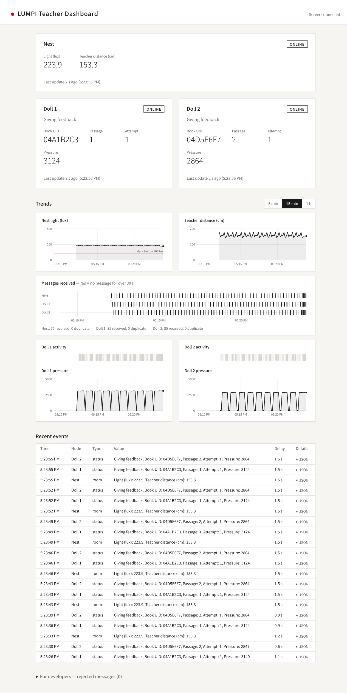

### 7.2 Why this order (top to bottom)

| Order | Block | Why here |
| --- | --- | --- |
| 1 | Header with server status | First thing to know: is anything on this page current? Right-aligned so it never competes with the title. |
| 2 | Nest card, full width | The nest is the gateway. If it is down, both dolls are down too, so it sits above them. Full width because it has only two values and reads as "the room". |
| 3 | Doll 1 and Doll 2 side by side | Two equal things, compared left vs right. Fixed positions by `node_id` so the teacher's eye always goes to the same place for the same doll. |
| 4 | Trends | Answers "what happened in the last minutes", e.g. *when* Doll 2 dropped. Below the cards because it is the second question, not the first. |
| 5 | Recent events | Raw detail for checking. Long, so near the bottom. |
| 6 | Developer panel, folded | Not for the teacher. Folded so it never distracts; the count in the title still says if something is wrong. |

Layout idea (title bar, card grid, table below) was taken from the
Adminator admin template, **but the template is not used** — it needs
Bootstrap and webpack, which breaks the no-build rule.

---

## 8. Visual design

### 8.1 Style: Japanese minimal

Lots of empty space, few elements per card, thin 1px lines instead of
shadows, no corner radius on cards, no gradients, no icons. The only
decoration is a small red circle before the title (hinomaru idea). Reason:
the page is looked at for one second at a time during a lesson; anything not
data is noise, and a quiet page makes the one red thing stand out.

### 8.2 Colour: 60 / 30 / 10

```css
:root {
  --white: #ffffff;   /* card and header background */
  --paper: #f7f5f2;   /* page background, <pre> background */
  --ink:   #1a1a1a;   /* text, ONLINE badge, chart lines, selected toggle */
  --grey:  #6b6b6b;   /* labels, secondary text, UNKNOWN badge */
  --line:  #d9d6d1;   /* 1px borders and dividers */
  --red:   #c8102e;   /* warnings only */
}
```

Extra fixed greys used only inside charts: `#ebe8e3` (grid lines, default
band), `#f4f2ee` (idle band), `#d9d6d1` (busy bands).

| Share | Colour | Used for |
| --- | --- | --- |
| 60 % | white / paper | backgrounds |
| 30 % | ink / grey | text, borders, ONLINE |
| 10 % | red | STALE, OFFLINE, disconnected, warnings, dark-room note, threshold line, timeline gaps, error left border, `stopped` band |

**Red means "look here" and nothing else.** It is never used for the title,
buttons, links or a chart series. Reason: if red is decoration, a stale card
no longer stands out. The title dot is the single exception, and it is tiny.

Contrast: ink on white and red on white both pass 4.5:1; white on red
(OFFLINE badge) is 6.4:1. Grey `#6b6b6b` is only used for small labels.

### 8.3 Typography

- Font: `"Noto Sans JP", system-ui, sans-serif`, weights 300/400/500 from
  Google Fonts (the only external resource; falls back to system-ui offline).
- Body 16px / 1.5, weight 400.
- `h1` 22px, weight 500, letter-spacing 0.04em.
- `h2` 18px, weight 500 (card titles, section titles).
- **Values: 28px, weight 300** (big and light), label above in 13px grey.
  Reason: the number is what the teacher reads; the label is only needed the
  first time.
- Badges: 13px, weight 500, letter-spacing 0.08em, uppercase text.
- Table and secondary text 14px; chart axis text 11px with
  `font-variant-numeric: tabular-nums` so numbers line up.

### 8.4 Spacing and sizes

| Element | Value |
| --- | --- |
| header padding | `32px 40px 24px`, white, 1px bottom `--line` |
| main | `max-width: 1100px; margin: 0 auto; padding: 32px 40px 48px` |
| card | white, `1px solid --line`, padding `24px 28px`, no radius, no shadow |
| doll grid | `grid-template-columns: 1fr 1fr; gap: 24px; margin-top: 24px` |
| values row | flex wrap, `gap: 16px 40px`, each item `min-width: 90px` |
| "Last update" line | 14px grey, `padding-top: 12px`, 1px top `--line` |
| section gaps | Trends / Events / Dev each `margin-top: 40px` |
| chart box | white, 1px `--line`, padding `16px 20px` |
| chart grid | `1fr 1fr`, gap 24px |
| title mark | 12×12 px red circle, 12px right margin |

### 8.5 Narrow screens (`max-width: 720px`)

Doll grid and chart grid become one column; header and main side padding
16px; table cell padding 8px. Nothing else changes.

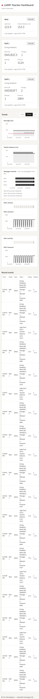

---

## 9. Components

### 9.1 Header and server connection

DOM:

```html
<header>
  <h1><span class="mark" aria-hidden="true"></span>LUMPI Teacher Dashboard</h1>
  <p id="connection" class="connection" role="status">Connecting…</p>
</header>
```

| State | Text | Look |
| --- | --- | --- |
| before first poll | `Connecting…` | grey 14px |
| poll succeeded | `Server connected` | grey 14px (quiet: good news needs no colour) |
| any of the 4 fetches failed | `Server disconnected — retrying` | red, weight 500 |

On disconnect also: `body.disconnected` → cards, table and chart boxes get
`opacity: 0.45`; every `.seen` line gets `::after { content: " — not current"; color: red }`;
every badge text becomes `NO SERVER` with the plain grey badge style.
Reason: without the server we do not know any node's status, so we must
never keep showing `ONLINE`. (Bug found in live testing: badges said ONLINE
while the server was down.) `role="status"` makes screen readers announce
the change.

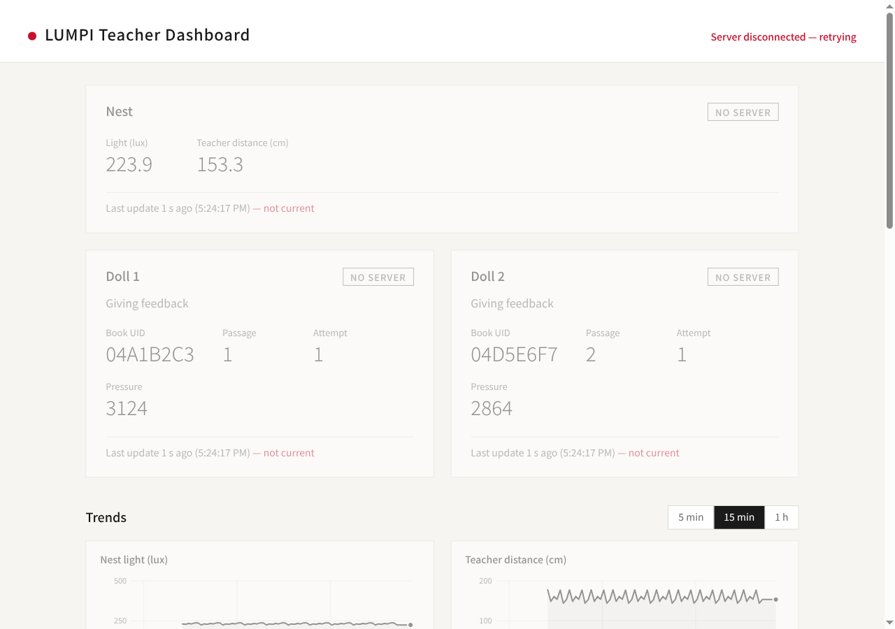

### 9.2 Node card (nest and dolls)

Why a card per node: the teacher thinks in devices ("is Doll 2 OK?"), not in
data streams.

DOM (fixed in HTML; `data-node` = node_id):

```html
<section class="card" data-node="1" aria-labelledby="title-1">
  <div class="card-head">
    <h2 id="title-1">Doll 1</h2>
    <span class="badge">UNKNOWN</span>
  </div>
  <p class="warning"></p>
  <p class="activity"></p>          <!-- dolls only -->
  <dl class="values"></dl>
  <p class="seen">No data yet</p>
</section>
```

The nest card has `class="card nest"`, no `.activity`, and an extra
`<p class="low-light" hidden>Room is dark (under 100 lux)</p>` after the
warning.

Order inside the card, and why: title + badge (who and how) → warning (what
is wrong, in words) → activity (what it is doing) → values (the numbers) →
last update (how fresh). Problem text is above the numbers so it is read
first.

Drawing rules (`drawNode(node)` in `app.js`):

1. Find card by `.card[data-node="<id>"]`; skip if none (node 3 has no card).
2. Badge text = `status.toUpperCase()`, class = `badge <status>`.
3. Toggle `is-stale` / `is-offline` on the card (red border).
4. Warning text:
   - stale: `<Name> — STALE. No update for <round(age_s)> seconds.`
   - offline: `<Name> — OFFLINE. Check power and Wi-Fi.`
   - else empty (`.warning:empty { display: none }` so it takes no space).
5. Nest: `low-light.hidden = node.low_light !== true`.
6. Unknown: clear values, `seen = "No data yet"`, clear activity, stop.
7. Activity: `ACTIVITY_TEXT[node.activity]`.
8. Values: known keys first in the order of `LABELS`, then any unknown keys
   (shown by raw name, so a new firmware field appears without a page
   change). Each is `<div><dt>label</dt><dd>value</dd></div>`. `null` →
   `no reading`.
9. `seen = "Last update <round(age_s)> s ago (<local clock time>)"`. Both
   relative and clock time: relative for "is it fresh", clock to match logs.

Mappings (top of `app.js`):

```js
const NODE_NAMES = { 0: "Nest", 1: "Doll 1", 2: "Doll 2", 3: "Doll 3" };
const LABELS = {
  lux: "Light (lux)", distance_cm: "Teacher distance (cm)",
  uid: "Book UID", passage: "Passage", attempt: "Attempt", fsr: "Pressure",
};
const ACTIVITY_TEXT = {
  idle: "Idle", book_on: "Book on the mat", recording: "Recording",
  waiting_ai: "Waiting for AI", feedback: "Giving feedback",
  quiet_study: "Quiet study", stopped: "Stopped (STOP button)",
};
```

#### Badge states

| Status | Badge text | Badge style | Card | Extra |
| --- | --- | --- | --- | --- |
| unknown | `UNKNOWN` | grey text, 1px grey border | normal | "No data yet", no values |
| online | `ONLINE` | ink text, 1px ink border | normal | — |
| stale (30–60 s) | `STALE` | red text, 1px red border | red border | red warning with seconds; **last values stay visible** |
| offline (> 60 s) | `OFFLINE` | white text on solid red | red border | red "Check power and Wi-Fi." |
| server lost | `NO SERVER` | grey (plain `.badge`) | faded 0.45 | "— not current" |

Badge base: `padding: 2px 10px; border: 1px solid; font-size: 13px; font-weight: 500; letter-spacing: 0.08em`.
Why three escalating looks: outline red = "watch", solid red = "act now".
Stale keeps the old values because the teacher may still want the last
known book and attempt.

Unknown (fresh server, nothing received):

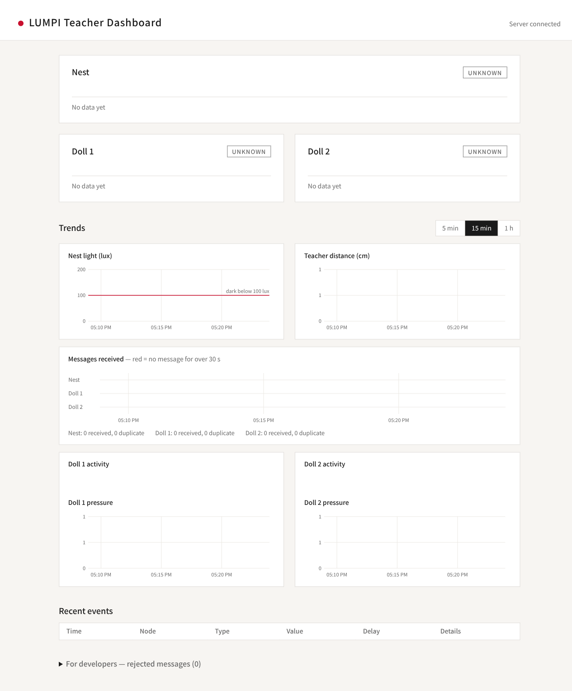

Online:

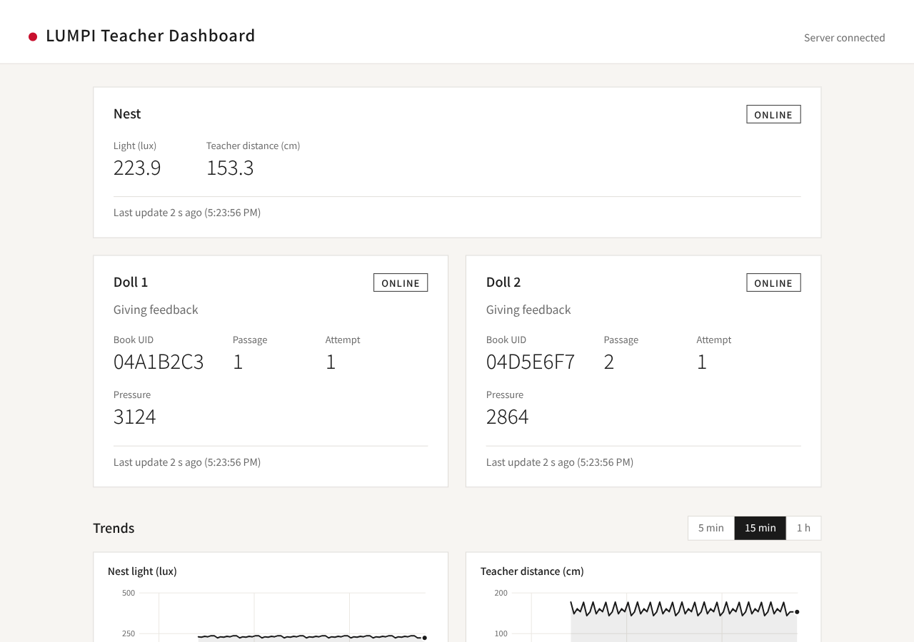

Doll 2 stale:

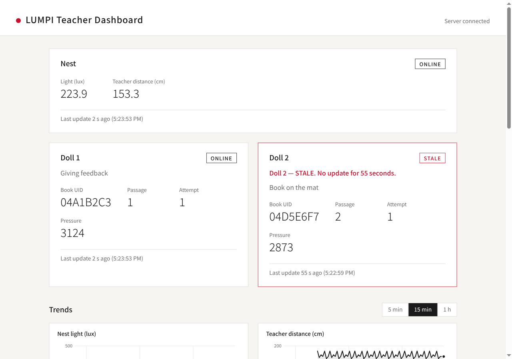

Doll 2 offline:

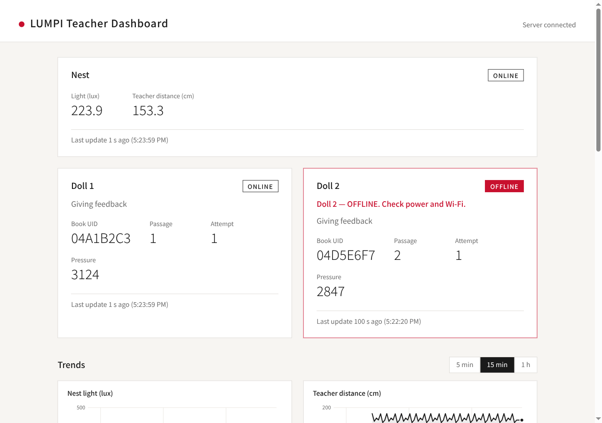

Dark room and failed sensors (nest `distance_cm` and Doll 1 `fsr` are `null`):

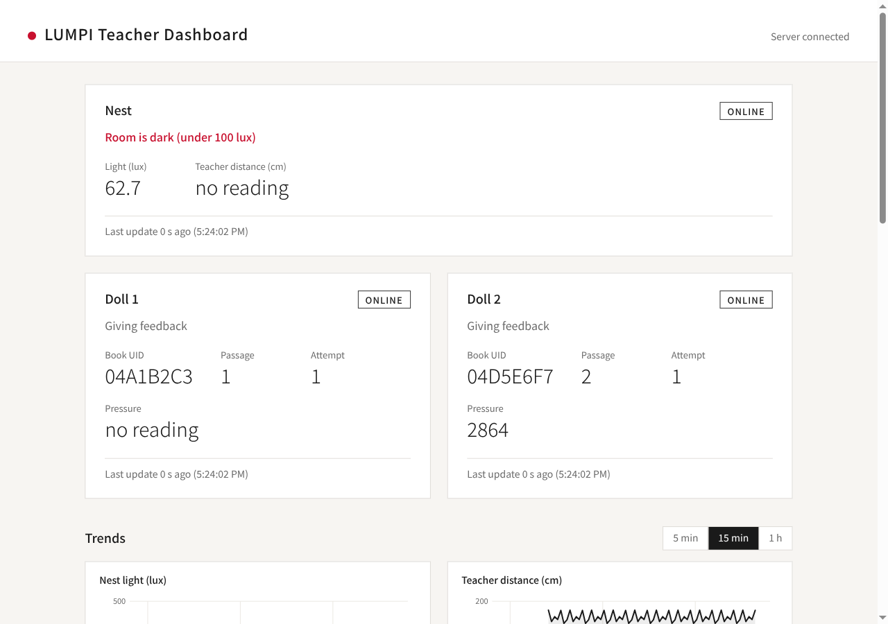

### 9.3 Trends section

Why: cards show *now*; trends show *when* something went wrong and whether
it is a pattern (flaky Wi-Fi vs one dead doll).

Head: `h2 Trends` on the left, a segmented toggle on the right:

```html
<fieldset class="range">
  <legend class="visually-hidden">Time range</legend>
  <label><input type="radio" name="range" value="5"> 5 min</label>
  <label><input type="radio" name="range" value="15" checked> 15 min</label>
  <label><input type="radio" name="range" value="60"> 1 h</label>
</fieldset>
```

Real radio inputs (keyboard and screen-reader work for free), visually
hidden (`position:absolute; opacity:0`); labels joined with 1px borders;
`label:has(input:checked)` = ink background, white text;
`label:has(input:focus-visible)` = 2px ink outline. Changing the range calls
`poll()` at once. Default 15 min: long enough for a lesson segment, short
enough to see 10 s heartbeats.

Charts, in this order:

| Box | Content | Why |
| --- | --- | --- |
| Nest light (lux) | line of `lux` with red threshold line at `dark_lux`, label "dark below 100 lux" | Shows when the room went dark |
| Teacher distance (cm) | line of `distance_cm` | Teacher near/far over time |
| Messages received (full width) | one row per node (Nest, Doll 1, Doll 2), one tick per message, red band for any gap > `stale_after_s` (30 s), "gap N s" text if band wider than 60 px; under it counters `<Name>: N received, M duplicate` | The best view of connection health; counters are raw data for delivery-rate tests |
| Doll 1 / Doll 2 (two columns) | activity strip, then sub-caption "Doll N pressure" and a pressure line | What each doll was doing and whether the book was on the mat |

Caption of the timeline includes the legend in words:
`Messages received — red = no message for over 30 s`.

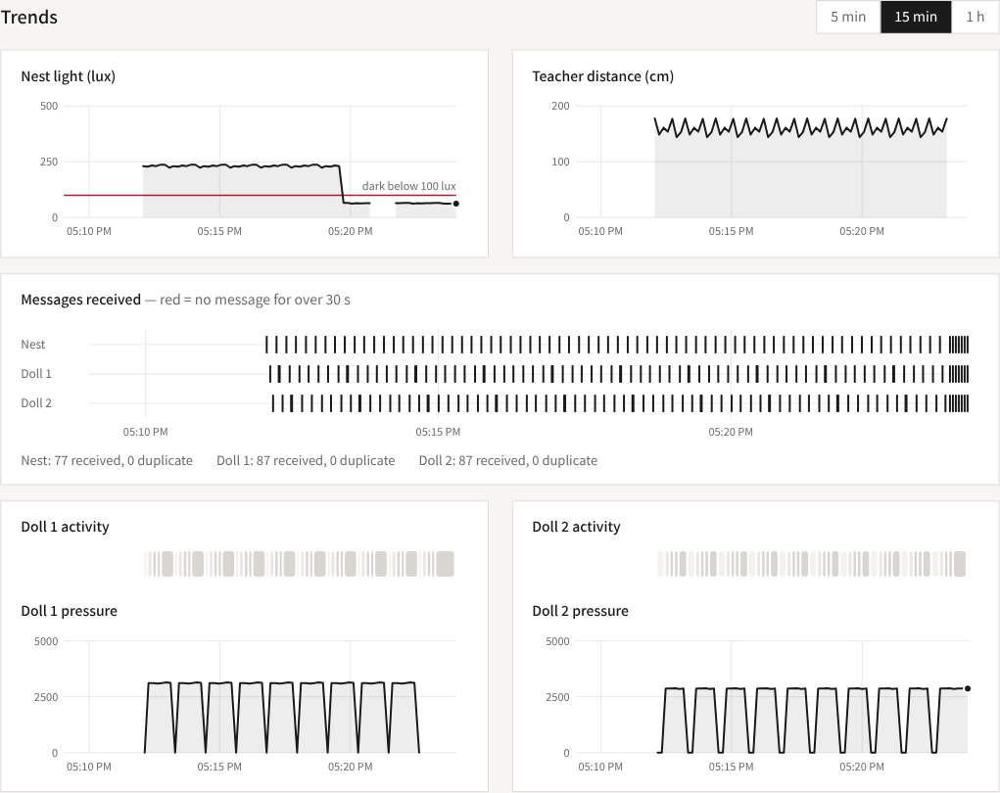

Flaky Wi-Fi (gaps on Doll 1, duplicates on Doll 2), 15 min and 5 min:

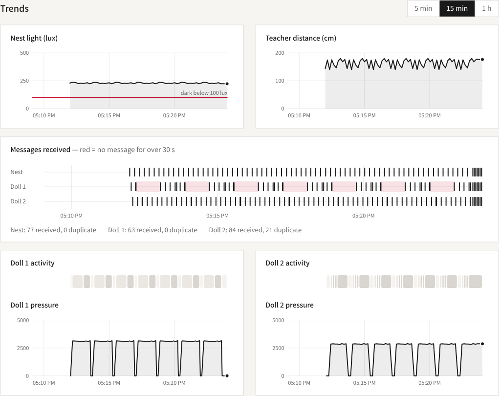

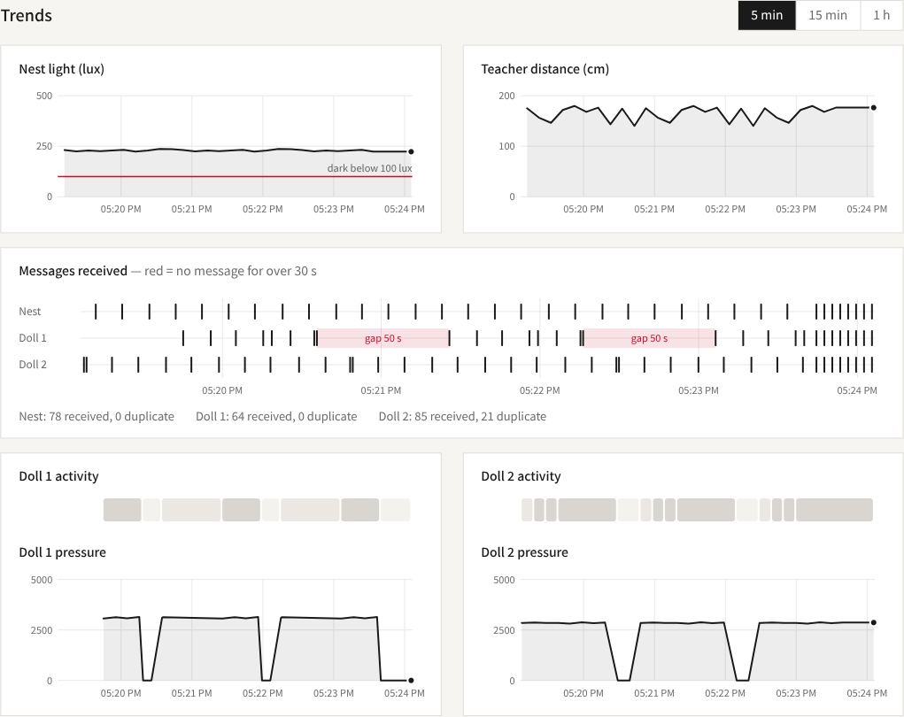

Doll 2 offline, seen in the timeline (red band from last message to now):

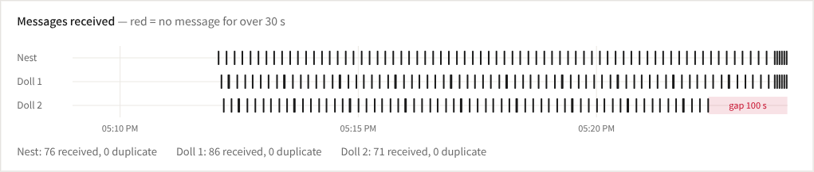

### 9.4 Chart rules (`charts.js`)

General:

- Hand-written SVG, `viewBox="0 0 <real pixel width> <height>"`,
  `width:100%; height:auto`. Width = `wrapper.clientWidth || 600`. Reason:
  drawing at real pixel width keeps 11px text the same size in every chart
  (bug found: scaled viewBoxes made text different sizes).
- Padding: left 44, right 12, top 12, bottom 24.
- One series per chart, line 2px ink, round joins/caps; area under the line
  ink at 8 % opacity; last point = 4px ink dot with 2px white stroke.
- Grid: 1px `#ebe8e3`; y grid at 0, 50 %, 100 % of a "nice" max
  (1, 2, 2.5, 5, 10 × power of ten, above max × 1.1, and above the
  threshold); x ticks every 1, 5 or 15 min (≈ 5 labels), `HH:MM`.
- Threshold line: red, 1.5px, label right-aligned above it.
- `null` value **breaks the line** into separate runs; each run gets its own
  area and line. A failed sensor is a gap, never a drop to zero.
- Every SVG has `role="img"` and an `aria-label` summary, e.g.
  `Light: latest 62.7, lowest 60.1, highest 238 lux`, or
  `Messages received. Doll 1 2 gaps.`, or
  `Activity over time. Now: Giving feedback. 14 changes.`
- Red only for threshold, gaps and the `stopped` band.

Line chart hover: on `pointermove`, find the nearest point by x, show a 1px
grey vertical crosshair, a dot on the point (hidden if `null`), and an HTML
tooltip (`.chart-tip`: ink background, white 12px text, no wrap,
`pointer-events:none`) with the clock time and `Name: value unit`. The tip
sits 12px right of the line, or flips to the left if it would overflow. Hide
all on `pointerleave`.

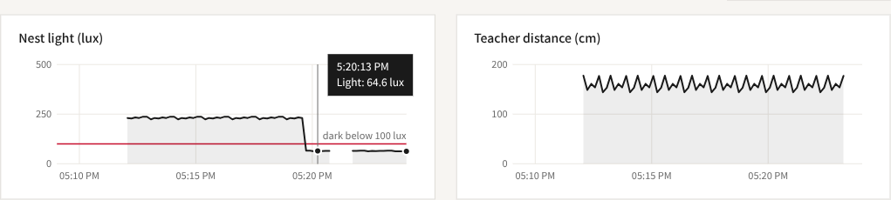

Timeline: row height 30, label column 70px, tick = 2px ink vertical line;
gaps checked between consecutive messages **and from the last message to
now**, so a dead node shows a growing red band. Each band has an SVG
`<title>` with the exact times.

Activity strip: height 44, bands 26px tall with radius 3, consecutive
same-activity points merged into one band, 2px space between bands instead
of borders. Fill: default `#ebe8e3`, `idle` `#f4f2ee`, `recording` /
`waiting_ai` / `feedback` `#d9d6d1`, `stopped` red with white label. Label
text inside the band only when it fits (`width > name.length * 7 + 8`);
every band has a `<title>` tooltip `Name: start to end`. Colour is never the
only cue (labels and titles carry the meaning).

Redraw rule: `drawTrends` skips the redraw while the mouse is over any
`.trends .chart` (`:hover`), because redrawing would remove the tooltip.

### 9.5 Recent events table

Why: lets a tester match a page value with the nest log and server log, and
see delay.

Columns: `Time | Node | Type | Value | Delay | Details` (`<th scope="col">`).

- Time = `recorded_at` as local clock time.
- Node = name from `NODE_NAMES`, or `Node N`.
- Type = raw `event_type`.
- Value = activity text first, then `Label: value` pairs in `LABELS` order,
  joined with `, `.
- Delay = `received_at - recorded_at`, one decimal + ` s` (raw data for the
  latency task).
- Details = a `<details>` with summary `JSON`, inside a small grey title
  `Received <time>` and a `<pre>` with the event (without `received_at`),
  2-space indented.

Table: full width, white, 1px border, 14px, cells `8px 16px`, 1px bottom
line, header weight 500 grey. `<pre>`: paper background, 1px border, 12px,
`white-space: pre-wrap; word-break: break-all`, so long JSON never makes the
page scroll sideways. Open `<details>` in a cell gets `min-width: 280px`.

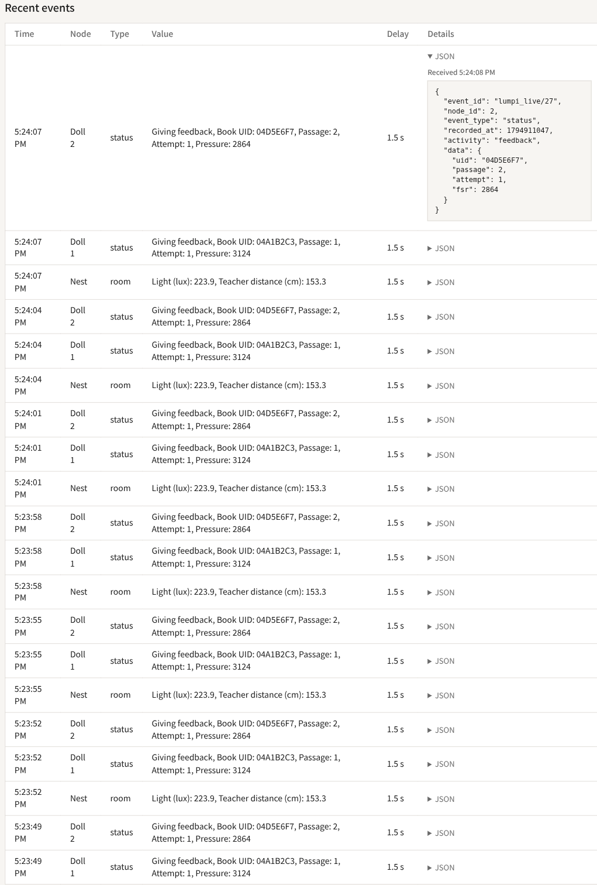

### 9.6 Developer panel

Why: when the nest firmware is wrong, the hardware developer should see the
reason on the same screen, with a fix, instead of reading the server
terminal.

```html
<section class="dev" aria-labelledby="dev-title">
  <details id="dev-panel">
    <summary><h2 id="dev-title">For developers — rejected messages (<span id="rejected-total">0</span>)</h2></summary>
    <p class="dev-intro">Messages the server refused. Click one to see the full packet, what is wrong, and a correct example. Newest first, last 50 kept.</p>
    <p class="dev-empty" id="dev-empty">No rejected messages.</p>
    <div id="error-list"></div>
  </details>
</section>
```

- Folded shut by default; title in grey 16px so it looks secondary.
- The total in the title counts all rejections ever, even past the 50 kept.
- Each error is a `<details>` card: white, 1px border, **3px red left
  border**; summary `<time> · from <ip> · <reason>`; inside four blocks,
  each a small grey title + body:
  1. `What is wrong` — reason
  2. `How to fix` — hint
  3. `What the server received` — raw in `<pre>`, or `(body not kept)` for
     token/length errors
  4. `A correct packet looks like` — example JSON in `<pre>`

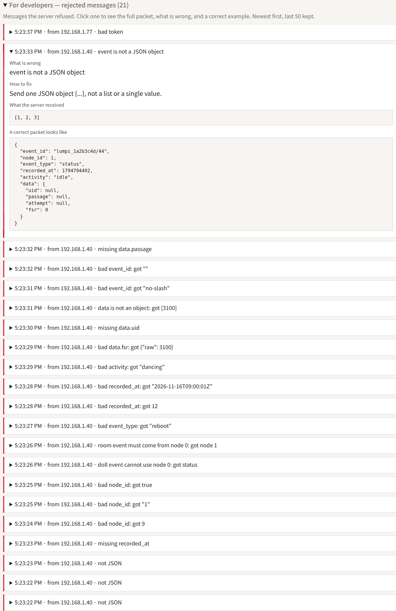

### 9.7 Keeping open things open

Lists are rebuilt with `replaceChildren`, which would close any open
`<details>`. So:

1. Rebuild a list only when its newest key changed (events: first
   `event_id`; errors: first `id`). Keys kept in `drawnEventsKey`,
   `drawnErrorsKey`.
2. Before rebuilding, collect `data-key` of every open `<details>`
   (`openKeys`), and after rebuilding set those open again (`reopen`).

Reason: the page refreshes every second; without this a developer could
never read an open error.

---

## 10. Polling loop (`app.js`)

```js
const POLL_MS = 1000;
let pollTimer = null;

async function poll() {
  clearTimeout(pollTimer);
  try {
    const [nodes, events, errors, history] = await Promise.all([
      getJson("/api/dashboard/nodes"),
      getJson("/api/dashboard/events"),
      getJson("/api/dashboard/errors"),
      getJson(`/api/dashboard/history?minutes=${chosenMinutes()}`),
    ]);
    nodes.forEach(drawNode);
    drawEvents(events);
    drawErrors(errors);
    drawTrends(history, nodes);
    setConnected(true);
  } catch (error) {
    console.warn("dashboard poll failed:", error);
    setConnected(false);
  }
  // Clear again: a range change may have started a second poll meanwhile.
  clearTimeout(pollTimer);
  pollTimer = setTimeout(poll, POLL_MS);
}
```

- `getJson` uses `fetch(path, { cache: "no-store" })` and throws on non-OK.
- `setTimeout` after each poll (not `setInterval`), so slow responses never
  pile up.
- All four in one `Promise.all`: one failure = disconnected. Simple and
  honest.

---

## 11. Full state list (what to check visually)

| # | State | How to make it | Expected | Screenshot |
| --- | --- | --- | --- | --- |
| 1 | Nothing received | start server, open page | 3 × `UNKNOWN`, "No data yet", empty charts, "No rejected messages." | `01_unknown_empty.png` |
| 2 | All online | `normal.jsonl` | 3 × `ONLINE`, values, activity, charts | `02_online_full.png`, `02b_online_top.png` |
| 3 | One doll stale | `doll2_dies.jsonl`, wait 30 s | Doll 2 `STALE`, red border, seconds in warning, values kept | `03_stale_doll2.png` |
| 4 | One doll offline | wait 60 s | Doll 2 solid red `OFFLINE`, red band to now in timeline | `04_offline_doll2.png`, `04b_offline_timeline_gap.png` |
| 5 | Server lost | stop server with page open | red header text, `NO SERVER`, faded, "— not current"; recovers by itself on restart | `05_server_disconnected.png` |
| 6 | Dark room / failed sensor | `sensor_fail.jsonl` or lux < 100 | red "Room is dark", "no reading", gaps in lines | `06_dark_room_sensor_fail_top.png`, `06b_dark_room_trends.png` |
| 7 | Chart hover | mouse over a line chart | crosshair, dot, tooltip; no redraw while hovering | `07_chart_hover_tooltip.png` |
| 8 | Flaky Wi-Fi | `flaky_wifi.jsonl` | red gaps on Doll 1, duplicate count on Doll 2 | `08_flaky_wifi_trends.png`, `08b_range_5min.png` |
| 9 | Event detail | click `JSON` | stays open through refreshes | `09_events_json_open.png` |
| 10 | Bad packets | `bad_packets.jsonl` | count in panel title, each with reason, hint, raw, example; state unchanged | `10_developer_panel_error_open.png` |
| 11 | Phone width | 390 px | one column, no sideways scroll on the page | `11_mobile_390.png` |

---

## 12. Test data and tools

Scenario file format (`tests/fixtures/dashboard/*.jsonl`), one line each:

```json
{"delay": 1.5, "event": {...}, "expect": "added"}
{"delay": 0.2, "raw": "broken text", "expect": "rejected"}
```

Scenarios: `normal` (both dolls reading), `doll2_dies` (Doll 2 stops),
`flaky_wifi` (gaps and duplicates), `sensor_fail` (`null` values), `busy`
(fast alternating dolls, no crossed values), `bad_packets` (20 different bad
inputs, one per rule).

`laptop/replay_events.py <file>` sends a file to `localhost:8080` with real
delays. It moves `recorded_at` to now and makes event IDs unique per run
(`<gateway>/<run>-<number>`), so the same file can be replayed without a
restart while duplicates inside a file stay duplicates. Prints one line per
message and how many results were not as expected.

`tests/test_dashboard_server.py` plays every scenario through
`handle_telemetry` with a fake clock and checks:

| ID | Do | Expect |
| --- | --- | --- |
| DASH-01 | no events | all `unknown` |
| DASH-02/03 | Doll 1 / Doll 2 event | only that node changes |
| DASH-04 | room event | nest shows lux |
| DASH-05 | Doll 2 quiet 30 s | `stale`, values kept |
| DASH-06 | Doll 2 sends again | `online` |
| DASH-07 | bad JSON, missing field, node 9, no token | rejected, state unchanged |
| DASH-08 | same `event_id` twice | stored once |
| DASH-09 | stop/restart server | page disconnected, then recovers (by hand) |
| DASH-10 | fast alternating dolls | no crossed values |

Also: every rejection has a non-empty hint; a late older event does not
overwrite newer values; a recorded file replays into a fresh server; the C++
builder's output is accepted by the server.

Run:

```bash
LUMPI_LAN_KEY=test python3 laptop/dashboard_server.py
LUMPI_LAN_KEY=test python3 laptop/replay_events.py tests/fixtures/dashboard/doll2_dies.jsonl
python3 -m unittest tests.test_dashboard_server
```

---

## 13. Things not to add

Login, book management, doll control, a database, a chart library, a CSS
framework, icons, dark theme, animations, WebSockets. They are out of scope
for this task or break the no-build / simple-code rules.

## 14. Known limits of the current version

- Activity strip labels only appear when a band is wide enough. With 15 min
  or 1 h of a busy lesson most bands are narrow, so the strip shows grey
  blocks; the name is in each band's hover title. Use 5 min to read labels.
- On phone width the events table wraps into tall rows; it stays inside the
  page but is long.
- State is in memory; a server restart starts empty.
- Duplicate check forgets IDs after 1000 events (one lesson).
