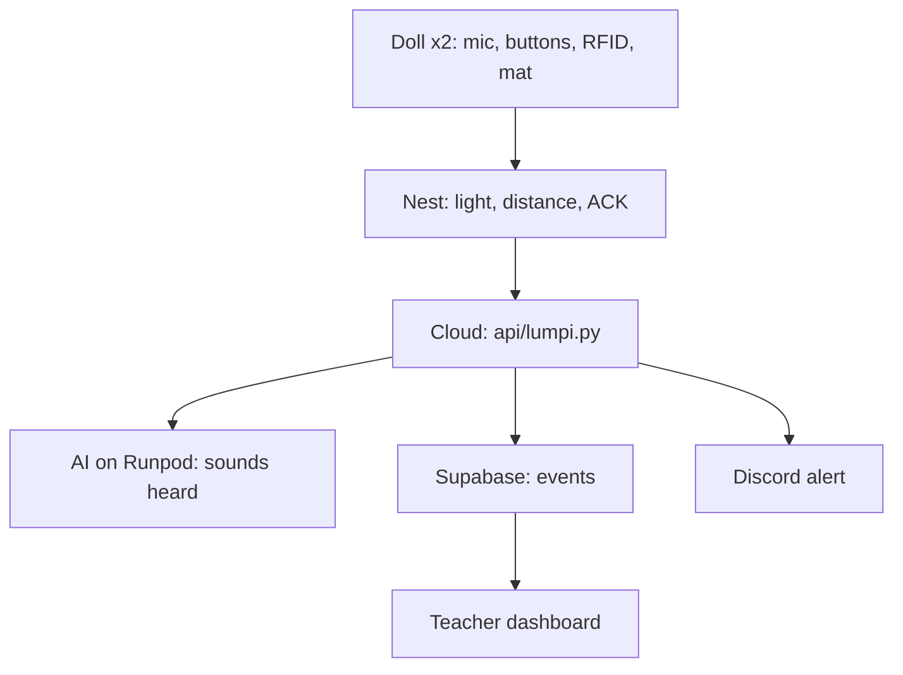

# Firmware and Discord review (2026-11-28, commit 4df4397)

Checked on the laptop only. Nothing here was run on a board.

## 1. The system

Pattern used everywhere: a **story** file (what LUMPI does), a **plumbing** file (how the hardware or
web does it), and **pure rules** in `src/common` that the laptop can test.

## 2. Function map

### Doll: `src/app/station/doll.cpp` (story)

| Part | Job |
| --- | --- |
| `capture_task` (core 1, priority 3) | Reads the mic into 8 kB blocks; in quiet mode measures noise |
| `net_task` (core 0, priority 2) | Only place that talks to the nest: heartbeat, upload, help, clips |
| `upload_reading` | start -> chunks -> finish -> wait for grade |
| `control_task` (core 1, priority 2) | Buttons, mode machine, mistake counts, mat, knob, RFID |
| `feedback_task` (core 1, priority 1) | `act_command`: screen, arm, tongue, sound for commands 1-8 |

Modes: idle, ready, recording, checking, quiet, dark.
Queues: button edges, free audio blocks, full audio blocks, network jobs, events, feedback jobs, clip slices.

`doll_parts.h` (plumbing), in file order: servos, button interrupts, mat/knob/RFID, mic and speaker,
OLED and IPA symbols, nest requests and clip stream, Wi-Fi/OTA, CSV lines.

### Nest: `src/app/gateway/nest.cpp` (story)

| Part | Job |
| --- | --- |
| `http_task` (priority 3) | One `on_...` function per doll message; never waits for the cloud |
| `room_task` (priority 2) | Every second: light, dark room, distance, ACK, screen, timeouts, 10 s reports |
| `cloud_task` (priority 1) | `grade` first, else `send_oldest_events` |
| `grade` | claim -> send recording -> read grade -> fetch up to 3 clips -> publish |
| `keep_event` | Every dashboard event goes to the flash outbox first |

`nest_parts.h` (plumbing): flash storage, outbox, clip download, file reply, OLED, ACK interrupt,
Wi-Fi watchdog, CSV lines.

### Shared rules: `src/common`

| File | Rules |
| --- | --- |
| `session.h` | One reading: idle -> recording -> assessing -> result; `DarkState`; `HelpState` |
| `doll_logic.h` | Read the grade lines, count misses (5 = propose teacher), knob pages, noise dB |
| `nest_logic.h` | Read the cloud grade, pick clips, build the doll's reply |
| `quiet_study_logic.h` | When to ask for quiet (30 s cooldown) |
| `dashboard_event.h` | Build the JSON events |
| `messages.h`, `query.h` | Route names, command numbers, query reader |

### Discord (commit bce0fb9)

`telemetry` stores the event, then `is_new_fresh_help` (new, not a resend, under 5 minutes old) calls
`send_discord` (3 s limit, never fails the request, never prints the webhook).

## 3. Integration results (rechecked 2026-11-28, after the fixes)

| Check | Result |
| --- | --- |
| Nest's room, start, status, help, noise events -> cloud checks and dashboard views | Pass |
| Help event -> one Discord call (stubbed) | Pass |
| All build environments, including `doll`, `doll_2`, `doll_sh1106`, `nest` | Pass (see section 6) |
| Doll filesystem image (`data_doll/`, 8 phrases, 356 kB) | Builds |
| Cloud reply -> nest `doll_reply()` -> doll parser | Pass: wrong word, its sounds, heard sounds and clip reach the doll |
| Same reading missed 5 times | Teacher proposal on the 5th |
| Recording of 10 s | Cloud accepts it; longer is refused |
| Part of a page (middle, across sentences, wrong first sound) | Graded on the words read, page word numbers kept |
| `/v1/book` title | Cloud route, nest cache and doll retry built and compile; title tested on the cloud side |
| Every sound in both real books has a glyph on the doll screen | Pass (38 symbols) |

Nothing here has run on a board yet.

## 4. Fixed on 2026-11-28

1. Doll link error: the 3 interrupt functions are `static`, not `inline`.
2. Cloud: 10 s / 14 s limits, part-of-page grading, `S`/`W`/`P` reply, `first_word` in score events;
   dashboard class view places words by page position.
3. E8 is the nest's BH1750 driver; the doll keeps the MFRC522 library (prompts say so).
4. Doll stacks: `net` 16 kB, `control` 8 kB (mistake counts static), `feedback` 6 kB.
5. Wi-Fi down when RECORD is pressed: the reading now ends with "let us try again" at once.
6. RECORD is ignored while the doll is still giving feedback (no overwritten reply, and the mic does
   not record the doll's own voice).
7. Spoken phrases made (`tools/make_phrases.py`) with their own upload folder `data_doll/`.
8. Nest connects to the real cloud, with the cloud's root certificates set (E5).
9. Retired laptop comments removed; dark limit 10/15 lx everywhere in the prompts.

Known, by design: the dashboard's light meter says "Too dark" below 80 lx (reading comfort);
the dolls are only blocked below 10 lx (lights off). A repeated word or phrase is matched
at one of its places (tested in `tests/test_cloud.py`).

## 5. Bloat (cleaned 2026-11-28)

Moved to `.old/2026-11-28-cleanup/`: `x_quiet_study`, `x_i2c_probe`, `x_pin_toggle`, the committed test
binary and the retired laptop dashboard prompt. Git no longer tracks `.old/`, `.omc/` or `.claude/`.

Removed: unused constants in `messages.h`, the `X-LUMPI-Token` header, the laptop default address,
unused grade fields in `doll_logic.h`, the `language` argument of `grade()` and `norm()`, and the
duplicated request and line-reading code.

Kept on purpose: `s5_*` (fallback until the real firmware passes on hardware), `s6_nest_to_dashboard`
(nest to dashboard connection test), ArduinoOTA (spare depth item E6).

Second pass (same day): OCR tool moved to `.old/` (books already made), unused `/v1/page` route,
one `query::cut()` for all text splitting, one audio pool size, `std::min_element`, one reset-reason list,
clip download through `lumpi_net::open()`, test-only count readers removed.

After the hardware tests pass: `s5_*`, `check_tools.h` (s3/s4 only), `flash_write_kb_per_s`, `on_status`.

For the presentation, the hardest function to explain is `control_task` (about 220 lines). Splitting it
into buttons, events and sensors would help.

## 6. Numbers

Code lines (no blank or comment-only lines), 10 958 in total, measured before the 2026-11-28 cleanup:

| Area | Lines |
| --- | --- |
| Bench sketches | 3446 |
| Dashboard | 2502 |
| Doll firmware | 1121 |
| Nest firmware | 973 |
| Tests | 817 |
| Shared C++ | 747 |
| Drivers | 551 |
| Cloud API | 388 |
| Book tools | 299 |
| Settings, AI worker | 114 |

Real firmware by topic (3130 lines, split by hand by line range): network 573, audio 491, grades 401,
tasks and state 384, teacher/quiet/dark 328, events and flash 312, screen and motion 293, inputs 272,
measurement 46, IPA symbols 30.

Test coverage (Python `coverage`, clang `llvm-cov`): all 6 C++ suites and 18 Python tests pass.

| Part | Lines run by tests |
| --- | --- |
| Shared C++ rules | 94% |
| `api/lumpi.py` | 96% |
| `api/_plumbing.py` | 82% |
| `tools/add_book.py` | 67% |
| `ocr_to_book.py`, `ai/app.py` | 0% |
| Doll, nest, drivers, dashboard | 0% |

## 7. Left to do (deadline 8 Dec 2026, 23:59)

1. New long `LUMPI_LAN_KEY` on Vercel and in every `config/private.h` (the owner does this).
2. Upload: nest, then doll 1 (code + Upload Filesystem Image), then doll 2. Stage 9 and 10 of
   `docs/testing-steps.md`.
3. Calibrate servos, mat, knob and light in the classroom; replace speaker amps if silent.
4. Books under the real tag IDs (`tools/add_book.py`); AI warm before class.
5. Failure tests, 24-hour run, at least 3 measured metrics.
6. Enclosure and wiring.
7. Report, slides, video, Q&A practice, peer evaluation.
